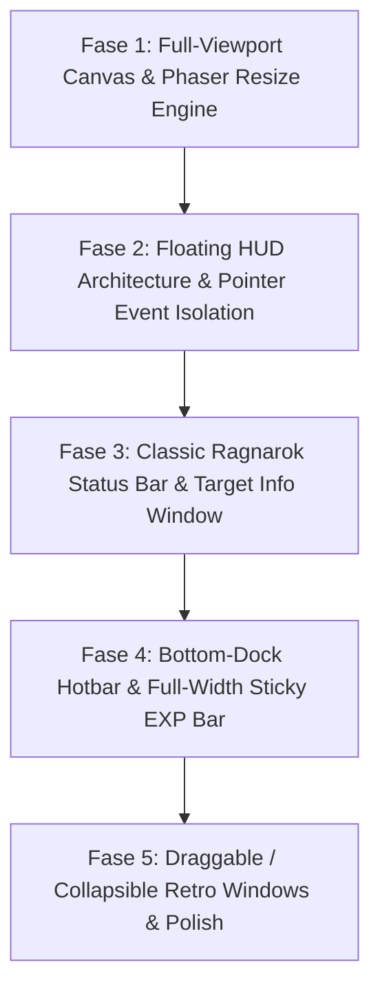

# IMPLEMENTATION PLAN: FULL-VIEWPORT WITH FLOATING RPG HUD
### Phased Architecture Blueprint for Immersive Browser-Based Ragnarok Online UI/UX

Dokumen ini merupakan panduan implementasi untuk merombak tata letak Mini Ragnarok dari model **Layout Boxed Web (Canvas di kiri, Sidebar panel di kanan)** menjadi **Full-Viewport Canvas 100vw/100vh** dengan **Floating Retro RPG HUD Overlay** yang otentik menyerupai Ragnarok Online klasik.

Setiap fase dieksekusi mengikuti **8-Step Learning Methodology** (Explain, Build, Explain the Code, Run, Test, Experiment, Review, Checkpoint).

---

## 🎯 Visi & Desain Arsitektur Baru

### Sebelum (Boxed Web Layout):
```text
+-------------------------------------------------------------+
| Header / Navbar (Title, Server Status, Save Banner)         |
+------------------------------------+------------------------+
|                                    | [Character Status]     |
|  Phaser Canvas Fixed 800x600       | [Target Info]          |
|  (Terbatas dalam kartu/container)  | [Inventory Panel]      |
|                                    | [Game Menu / Action]   |
+------------------------------------+------------------------+
```

### Sesudah (Full-Viewport + Classic Floating RPG Windows):
```text
+-------------------------------------------------------------+
| [Top-Left]               [Top-Center]           [Top-Right] |
| RO Character Status Bar  Target Lock HP Bar     Server Ping |
| (Basic/Job HP/SP Lv Bar)                        & Online Count
|                                                             |
|                                                             |
|                    🎮 PHASER GAME CANVAS                    |
|                (FULLSCREEN 100vw x 100vh)                   |
|               Auto-Resize & Responsive World                |
|                                                             |
|                                                             |
| [Bottom-Left]                                [Bottom-Right] |
| Retro Chat Log Box                           Shortcut Dock  |
| [All | Whisper | Party]                      [Items/Skills] |
+-------------------------------------------------------------+
| [Bottom-Center/Edge] Fixed Full-Width Base & Job EXP Bar    |
+-------------------------------------------------------------+
```

---

## 🛠️ Ringkasan Perubahan Teknis

| Bagian | Implementasi Lama | Desain Baru (Full-Viewport + Floating HUD) |
|---|---|---|
| **Canvas Scaling** | `Phaser.Scale.FIT` (800x600 fixed) | `Phaser.Scale.RESIZE` dengan `width: '100%'`, `height: '100%'` |
| **Canvas Container** | `div` terbatas dalam grid `max-w-6xl` | `fixed inset-0 w-screen h-screen overflow-hidden` (Z-index 0) |
| **HUD Layering** | Sidebar vertikal (`aside w-80`) | `pointer-events-none` container dengan floating windows `pointer-events-auto` (Z-index 10) |
| **Retro Windows** | Card Tailwind modern flat | Glassmorphism retro Ragnarok (beveled border, draggable/collapsible, compact RO font styling) |
| **EXP Display** | Bar mini di sidebar kanan | Full-width bottom sticky gauge (0.0% ~ 100.0%) khas Ragnarok Online |

---

## 🗺️ Roadmap Fase Eksekusi



---

## 📋 Rincian Fase Implementasi (Fase 1 s/d 5)

---

### 🟢 Fase 1 — Full-Viewport Canvas & Phaser Resize Engine
- **Tujuan**: Membuat canvas Phaser memenuhi layar browser secara penuh (`100vw x 100vh`) tanpa scrollbar, serta kamera game tetap berpusat pada karakter saat ukuran jendela browser diubah (*window resize*).
- **Explain**:
  - Perbedaan `Phaser.Scale.FIT` vs `Phaser.Scale.RESIZE`.
  - Mengapa `window.innerHeight` pada browser mobile/desktop membutuhkan penanganan CSS `h-screen h-[100dvh]`.
  - Update `this.cameras.main.setViewport` dan perataan zoom kamera pada dunia 1600x1200.
- **Build**:
  - Modifikasi `src/game/config/phaserConfig.ts`: beralih ke `Phaser.Scale.RESIZE`.
  - Modifikasi `src/components/GameCanvas.tsx` dan `src/components/GameLayout.tsx`: menggunakan layout container `fixed inset-0 w-full h-full`.
  - Event listener resize di `MainScene.ts` untuk menjaga kamera tetap tracking pemain utama.
- **Explain the Code**: Menjelaskan konfigurasi resize Phaser dan integrasi CSS viewport Tailwind.
- **Run**: Menjalankan aplikasi dengan `npm run dev:all` dan memverifikasi canvas memenuhi seluruh layar browser.
- **Test**: Resize ukuran browser ke berbagai dimensi; pastikan tidak ada garis hitam (*letterbox*) dan canvas merender penuh.
- **Experiment**: Ubah tingkat zoom kamera (`cameras.main.setZoom(1.2)`) untuk melihat pengaruh terhadap viewport luas.
- **Review**: Potensi lag bila resolusi sangat besar (4K) jika tidak dibatasi pixel ratio.
- **Checkpoint**: Layar canvas memenuhi 100% viewport browser tanpa scrollbar.

---

### 🟢 Fase 2 — Floating HUD Architecture & Pointer Event Isolation
- **Tujuan**: Membangun layer overlay UI React di atas canvas Phaser dengan pemisahan event klik yang presisi (pemain bisa klik tanah untuk jalan tanpa terhalang HUD kosong).
- **Explain**:
  - Konsep CSS `pointer-events-none` pada overlay wrapper dan `pointer-events-auto` pada elemen jendela interaktif.
  - Z-Index layering: Background Canvas (z-0), HUD Panels (z-10), Modal & Chat Input (z-20), Tooltip/Floating Text (z-30).
- **Build**:
  - Membuat arsitektur layout overlay di `src/components/hud/FloatingHUDContainer.tsx`.
  - Menempatkan indikator koneksi server MMO dan ping badge di pojok atas secara elegan dan transparan.
- **Explain the Code**: Menjelaskan cara kerja event pass-through antara DOM React dan canvas WebGL/Phaser.
- **Run**: Buka game dan klik area kosong di samping/bawah HUD.
- **Test**: Klik di area layar kosong tembus ke canvas (pemain bergerak/menyerang), sedangkan klik tombol pada jendela HUD memicu aksi UI tanpa menggerakkan karakter.
- **Experiment**: Coba tambahkan tombol minimize di salah satu widget.
- **Review**: Jebakan klik tembus saat drag cursor dari luar window ke dalam canvas.
- **Checkpoint**: Layering HUD mengambang sempurna di atas viewport game dan tidak memblokir pergerakan karakter di area transparan.

---

### 🟢 Fase 3 — Classic Ragnarok Status Bar & Target Info Window
- **Tujuan**: Merombak tampilan bar status pemain dan target monster menjadi widget retro khas Ragnarok Online (Basic Information Window).
- **Explain**:
  - Anatomi jendela status RO: Nama Karakter, Job title, Base Lv, Job Lv, Bar HP hijau, Bar SP biru, Zeny count.
  - Desain Target Window yang menempel di bagian atas-tengah (*boss/target bar*) yang hanya muncul saat monster ditarget atau dipukul.
- **Build**:
  - Perombakan `src/components/hud/CharacterStatus.tsx` menjadi floating window bergaya retro RO (beveled edge, translucent dark navy background, gold accents).
  - Perombakan `src/components/hud/MonsterTargetInfo.tsx` menjadi floating target panel di bagian atas tengah layar.
- **Explain the Code**: Bedah style CSS retro (border beveled khas RO, gradient bar HP/SP).
- **Run**: Menjalankan game dan menguji tampilan status di pojok kiri atas.
- **Test**: Serang Poring/Wolf; pastikan bar target monster muncul di posisi atas-tengah dan HP berkurang secara visual.
- **Experiment**: Tambahkan avatar portrait kecil di samping status karakter.
- **Review**: Memastikan teks HP/SP tidak overflow saat angka menyentuh ratusan ribu.
- **Checkpoint**: Karakter status & Target bar tampil otentik mengambang di pojok kiri atas & tengah atas layar.

---

### 🟢 Fase 4 — Bottom-Dock Hotbar & Full-Width Sticky EXP Bar
- **Tujuan**: Menambahkan Quickslot/Hotbar (F1-F9 / 1-9) di kanan bawah dan EXP Bar tipis membentang horizontal penuh di bagian paling bawah layar persis Ragnarok Online.
- **Explain**:
  - Desain UI Ragnarok klasik: EXP Bar berada di dasar layar paling bawah dengan indikator persentase detail (misal: `[EXP: 45.5%]`).
  - Hotbar dock untuk consumable potion (Red Potion, Meat) dan shortcut aksi.
- **Build**:
  - Pembuatan komponen `src/components/hud/BottomExpBar.tsx` (sticky `bottom-0 left-0 right-0`).
  - Pembuatan komponen `src/components/hud/QuickSlotBar.tsx` (slot item F1-F4 atau 1-4 dengan shortcut keyboard).
  - Reposisi `ChatWindow.tsx` agar berada di pojok kiri bawah tepat di atas EXP bar.
- **Explain the Code**: Integrasi event keyboard global untuk konsumsi potion via Hotbar.
- **Run**: Buka game, tekan angka 1 untuk minum Red Potion dari hotbar.
- **Test**: Kalahkan monster; amati pergerakan bar EXP di dasar layar dari kiri ke kanan dengan label persentase dinamis.
- **Experiment**: Kustomisasi warna EXP bar (kuning keemasan khas Ragnarok).
- **Review**: Menjaga agar chat box tidak bertubrukan dengan hotbar di resolusi layar kecil/laptop.
- **Checkpoint**: EXP bar membentang di bagian bawah layar dan Hotbar responsif terhadap input tombol.

---

### 🟢 Fase 5 — Draggable / Collapsible Retro Windows & Polish
- **Tujuan**: Memberikan kemampuan drag-and-drop pada jendela HUD (Status, Inventory, Chat) serta tombol toggle hide/minimize (shortcut `Alt+V`, `Alt+E`).
- **Explain**:
  - State posisi window (`{ x, y, isOpen, isMinimized }`) menggunakan penyimpanan local / memory.
  - Event mouse move & pointer capture untuk drag window yang mulus tanpa jitter.
- **Build**:
  - Membuat wrapper component `DraggableRetroWindow.tsx` dengan handle header retro.
  - Menghubungkan Inventory (`InventoryPanel.tsx`) ke floating draggable window yang bisa dibuka-tutup dengan tombol `I` atau ikon di dock.
- **Explain the Code**: Bedah implementasi dragging pada komponen React dengan batasan boundary layar.
- **Run**: Buka inventory, drag jendela ke tengah canvas, lalu minimalkan.
- **Test**: Jendela dapat digeser ke posisi mana pun di viewport tanpa keluar dari batas layar.
- **Experiment**: Tambahkan suara SFX klik retro saat tombol window di-click.
- **Review**: Mencegah event drag memicu aksi jalan (*click to move*) di canvas game.
- **Checkpoint**: Seluruh jendela HUD dapat di-toggle, di-drag, dan game terasa seperti client Ragnarok Online yang sesungguhnya.

---

## 📋 Matriks Status Pelaksanaan

| Fase | Fitur UI/UX Full-Viewport & Floating HUD | Status | Tanggal Eksekusi |
|---|---|:---:|:---:|
| **Fase 1** | Full-Viewport Canvas & Phaser Resize Engine (`100vw x 100vh`) | ✅ Selesai | 06 Nov 2026 |
| **Fase 2** | Floating HUD Architecture & Pointer Event Isolation | ✅ Selesai | 06 Nov 2026 |
| **Fase 3** | Classic Ragnarok Status Bar & Target Info Window | ✅ Selesai | 06 Nov 2026 |
| **Fase 4** | Bottom-Dock Hotbar & Full-Width Sticky EXP Bar | ✅ Selesai | 06 Nov 2026 |
| **Fase 5** | Draggable / Collapsible Retro Windows & Polish (Alt+V/E) | ✅ Selesai | 06 Nov 2026 |

---

> 🎮 **Langkah Berikutnya:**
> Rencana implementasi telah diperbarui untuk **Full-Viewport Canvas dengan Floating Retro RPG HUD**.
> Konfirmasikan untuk segera memulai **Fase 1: Full-Viewport Canvas & Phaser Resize Engine**.
