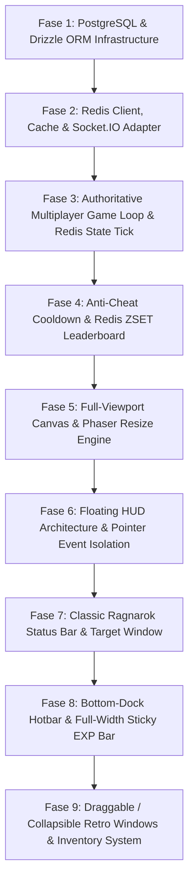

# IMPLEMENTATION PLAN: MINI RAGNAROK MMO
### Full-Stack Distributed Game Architecture (PostgreSQL + Redis + Socket.IO + Phaser 3 + React 19)

Dokumen ini merupakan panduan implementasi master arsitektur **Mini Ragnarok (2D Browser-Based Action MMORPG)**.
Sistem dibangun dengan arsitektur backend terdistribusi: **PostgreSQL** (Drizzle ORM) sebagai data storage persisten, **Redis** (ioredis + Socket.IO Redis Adapter) untuk in-memory cache, pub/sub, dan rate-limiting, serta **Phaser 3** + **React 19** pada frontend dengan tampilan **Full-Viewport & Retro Floating HUD**.

Setiap fase dieksekusi secara ketat mengikuti **8-Step Learning Methodology**:
*(1. Explain, 2. Build, 3. Explain the Code, 4. Run, 5. Test, 6. Experiment, 7. Review, 8. Checkpoint)*.

---

## 🏗️ 1. Arsitektur Distributed Game Stack

```text
+---------------------------------------------------------------------------------+
|                               CLIENT LAYER (Browser)                            |
|  [Phaser 3 Canvas (Full-Viewport)]  <--->  [Zustand Store]  <--->  [React 19 HUD]|
|                 ^                                                               |
|                 | (WebSockets / Socket.IO Client)                               |
+-----------------|---------------------------------------------------------------+
                  v
+---------------------------------------------------------------------------------+
|                           GAME SERVER (Node.js + Express)                       |
|   - Authoritative Game Loop (20 TPS Tick Rate)                                  |
|   - Combat Engine & Monster AI State Machine                                    |
|   - Anti-Cheat & Action Cooldown (Redis Limiter)                                |
+---------------------------------------------------------------------------------+
          |                                                               |
          | In-Memory Cache, Pub/Sub & TTL                                | Persistence (ACID)
          v                                                               v
+------------------------------------+           +--------------------------------+
|       REDIS (VPS Docker)           |           |     POSTGRESQL (VPS Docker)    |
| - Socket.IO Adapter (@socket.io)   |           | - Drizzle ORM Type-Safe Schema |
| - Player Transient State & Pos     |           | - Characters & Base Stats      |
| - Cooldown & Rate Limiter          |           | - Permanent Inventory & Equip  |
| - Leaderboard (ZSET Level/Kills)   |           | - Accounts & Auth Logs         |
+------------------------------------+           +--------------------------------+
```

---

## 🗺️ Roadmap Fase Eksekusi



---

## 📋 Rincian Fase Implementasi (Fase 1 s/d 9)

---

### 🟢 Fase 1 — PostgreSQL & Drizzle ORM Infrastructure
- **Tujuan**: Mengganti SQLite lokal dengan PostgreSQL remote (VPS Docker) menggunakan Drizzle ORM untuk manajemen schema, migrasi type-safe, dan data persisten karakter/inventori.
- **Explain**:
  - Mengapa PostgreSQL untuk data inti MMORPG (ACID compliance, transaksi inventory tanpa duplikasi item).
  - Keunggulan Drizzle ORM vs Prisma (zero-overhead, lightweight, SQL-like syntax).
  - Skema tabel: `characters`, `inventories`, dan auto-login logic.
- **Build**:
  - Konfigurasi `drizzle.config.ts` dan schema di `server/src/db/schema.ts`.
  - Inisialisasi koneksi pool PostgreSQL di `server/src/db/index.ts` menggunakan library `postgres` / `drizzle-orm`.
  - Migrasi skema ke PostgreSQL VPS via `drizzle-kit push`.
  - Refactor `dbService` untuk mendukung operasi async PostgreSQL.
- **Explain the Code**: Bedah struktur query Drizzle (`eq`, `select`, `insert`, `update`) dan connection pooling.
- **Run**: Jalankan migration `npx drizzle-kit push` dan start server `npm run dev:server`.
- **Test**: Buka game, masukkan nama pemain baru, verifikasi row data masuk ke tabel `characters` di PostgreSQL VPS.
- **Experiment**: Tambahkan kolom baru `guild_name` atau `job_class` pada skema dan lakukan push schema.
- **Review**: Penanganan network timeout/reconnect pada koneksi remote database VPS.
- **Checkpoint**: Server terkoneksi stabil ke PostgreSQL VPS via Drizzle ORM dan data akun tersimpan secara persisten.

---

### 🟢 Fase 2 — Redis Client, Cache & Socket.IO Adapter
- **Tujuan**: Menghubungkan game server ke Redis VPS, mengimplementasikan `@socket.io/redis-adapter` untuk pub/sub multiplayer, serta helper caching state pemain.
- **Explain**:
  - Arsitektur Socket.IO Adapter: Mengapa adapter dibutuhkan untuk scaling multi-instance / zero-downtime server.
  - Penanganan latency network dan error event listener pada Redis client (`ioredis`).
- **Build**:
  - Setup singleton Redis client (`pubClient` & `subClient`) di `server/src/redis/index.ts`.
  - Integrasikan adapter ke Socket.IO server: `io.adapter(createAdapter(pubClient, subClient))`.
  - Buat helper method Redis: `savePlayerSession`, `getPlayerSession`, `deletePlayerSession`.
- **Explain the Code**: Alur kerja Pub/Sub Socket.IO Adapter dalam menyebarkan paket socket ke channel Redis.
- **Run**: Start server; pastikan log terminal menunjukkan `[Redis] Connected to VPS Redis successfully`.
- **Test**: Connect 2 client browser; periksa keys di Redis CLI VPS (`KEYS *` atau `HGETALL player:session:*`).
- **Experiment**: Uji coba mengirim pesan via `pubClient.publish('game:broadcast', ...)` dan tangkap di subscriber.
- **Review**: Mengatasi connection leak jika socket disconnect tidak membersihkan session Redis.
- **Checkpoint**: Socket.IO terintegrasi dengan Redis Adapter dan session player tersimpan di Redis VPS.

---

### 🟢 Fase 3 — Authoritative Multiplayer Game Loop & Redis State Tick
- **Tujuan**: Memisahkan pergerakan realtime berkecepatan tinggi ke Redis in-memory cache, lalu menyimpan snapshot ke PostgreSQL secara periodik (Write-behind cache).
- **Explain**:
  - *Write-behind caching pattern*: Mengapa game multiplayer tidak boleh menulis koordinat X,Y ke disk SQL setiap frame tick.
  - Sinkronisasi Game Loop 20 TPS (50ms interval) di server.
- **Build**:
  - Update `server/src/index.ts`: Setiap tick, simpan transient position & HP pemain ke Redis Hash (`player:<id>:state`).
  - Timer background cron (misal tiap 30-60 detik) untuk batch sync data dari Redis ke PostgreSQL via Drizzle.
- **Explain the Code**: Logika snapshot batch update untuk menghemat IOPS database disk.
- **Run**: Gerakkan karakter di browser; pantau update key `player:<id>:state` di Redis.
- **Test**: Force-kill server, pastikan state terakhir minimal tersimpan sesuai flush snapshot terakhir.
- **Experiment**: Sesuaikan interval sync interval dari 30 detik menjadi 10 detik dan amati performanya.
- **Review**: Resiko data loss jika server mati mendadak sebelum periodic sync (penanganan `SIGTERM`/`SIGINT` graceful shutdown).
- **Checkpoint**: Koordinat dan HP dinamis terkelola di Redis dan tersinkronisasi berkala ke PostgreSQL.

---

### 🟢 Fase 4 — Anti-Cheat Cooldown & Redis ZSET Leaderboard
- **Tujuan**: Memanfaatkan Redis Atomic Commands & TTL untuk mencegah spam serangan / potion (Anti-Cheat), serta Redis Sorted Sets (ZSET) untuk realtime rank leaderboard.
- **Explain**:
  - Token Bucket / Atomic SET NX EX untuk cooldown skill & delay serangan (ASPD).
  - Algoritma Redis ZSET (`ZADD`, `ZINCRBY`, `ZREVRANGE`) dengan kompleksitas O(log N).
- **Build**:
  - Middleware / Helper Cooldown: `canPerformAction(playerId, actionType, cooldownMs)` menggunakan Redis key TTL.
  - Leaderboard System di `server/src/redis/leaderboard.ts` untuk melacak `leaderboard:level` dan `leaderboard:kills`.
  - Endpoint socket baru `request:leaderboard` yang mengirimkan Top 10 pemain.
- **Explain the Code**: Penggunaan Redis `SET ... NX PX` untuk concurrency lock tindakan pemain.
- **Run**: Coba spam klik serangan atau minum potion dalam rentang 100ms.
- **Test**: Server menolak paket serangan jika cooldown belum selesai. Cek perolehan peringkat di leaderboard setelah monster mati.
- **Experiment**: Tambahkan kategori leaderboard baru: `leaderboard:zeny`.
- **Review**: Sinkronisasi penghapusan leaderboard saat akun direset/dihapus.
- **Checkpoint**: Anti-cheat action cooldown aktif via Redis dan fitur Leaderboard Top 10 berfungsi instan.

---

### 🟢 Fase 5 — Full-Viewport Canvas & Phaser Resize Engine
- **Tujuan**: Membuat canvas Phaser memenuhi layar browser secara penuh (`100vw x 100vh`) tanpa scrollbar, dengan kamera game auto-centering.
- **Explain**:
  - Perbedaan `Phaser.Scale.FIT` vs `Phaser.Scale.RESIZE`.
  - CSS layout `fixed inset-0 w-screen h-screen overflow-hidden`.
- **Build**:
  - Modifikasi `src/game/config/phaserConfig.ts` ke mode `Phaser.Scale.RESIZE`.
  - Perbarui `GameCanvas.tsx` dan `GameLayout.tsx` untuk menampung canvas fullscreen.
  - Pasang resize listener di `MainScene.ts` untuk camera viewport recalculation.
- **Explain the Code**: Mekanisme resize handling Phaser di React container.
- **Run**: Buka game di browser dengan mode fullscreen / F11.
- **Test**: Ubah ukuran window browser; verifikasi game canvas beradaptasi mulus tanpa letterbox hitam.
- **Experiment**: Sesuaikan tingkat zoom kamera default (`cameras.main.setZoom(1.0)`).
- **Review**: Batasi device pixel ratio agar tidak membebani GPU di layar resolusi tinggi (Retina/4K).
- **Checkpoint**: Canvas game merender penuh 100% viewport secara responsif.

---

### 🟢 Fase 6 — Floating HUD Architecture & Pointer Event Isolation
- **Tujuan**: Membangun layer overlay UI React transparan di atas canvas Phaser tanpa memblokir klik mouse ke dunia game.
- **Explain**:
  - Konsep CSS `pointer-events-none` pada root overlay dan `pointer-events-auto` pada interactive windows.
  - Z-Index layering yang rapi (Canvas z-0, HUD z-10, Modals z-20).
- **Build**:
  - Buat komponen `src/components/hud/FloatingHUDContainer.tsx`.
  - Integrasikan indikator ping, FPS, dan status koneksi server MMO di pojok kanan atas.
- **Explain the Code**: Pembagian event interaksi mouse antara React DOM dan canvas WebGL.
- **Run**: Klik area kosong di tengah dan samping layar.
- **Test**: Karakter berjalan ketika klik area kosong, namun merespons tombol jika mengklik jendela HUD.
- **Experiment**: Tambahkan toggle tombol untuk menyembunyikan seluruh HUD (*Cinematic Mode*).
- **Review**: Mencegah click-through saat pemain menyeret mouse keluar dari jendela HUD.
- **Checkpoint**: HUD mengambang sempurna di atas viewport dan tidak menghalangi pergerakan karakter.

---

### 🟢 Fase 7 — Classic Ragnarok Status Bar & Target Window
- **Tujuan**: Merombak tampilan bar status pemain dan target monster menjadi widget retro khas Ragnarok Online.
- **Explain**:
  - Anatomi jendela status RO: Nama Karakter, Job title, Base Lv, Bar HP hijau, Bar SP biru, Zeny count.
  - Floating target monster bar di area atas-tengah layar.
- **Build**:
  - Perombakan `CharacterStatus.tsx` dengan styling retro (beveled border, warna klasik navy Ragnarok).
  - Perombakan `MonsterTargetInfo.tsx` menjadi floating target panel di bagian atas tengah layar.
- **Explain the Code**: Styling retro CSS dan sinkronisasi reaktif data dari Zustand store.
- **Run**: Serang monster di game.
- **Test**: Target window muncul di atas tengah saat monster dipilih/diserang, dan HP berkurang akurat.
- **Experiment**: Tambahkan badge status efek (misal ikon buff atau status stun).
- **Review**: Format angka HP/SP ribuan (`1,250 / 2,000`) agar rapi.
- **Checkpoint**: Jendela status karakter dan target monster tampil otentik bergaya Ragnarok Online.

---

### 🟢 Fase 8 — Bottom-Dock Hotbar & Full-Width Sticky EXP Bar
- **Tujuan**: Menambahkan Quickslot/Hotbar (1-9 / F1-F9) dan EXP Bar tipis di dasar layar (0.0% ~ 100.0%).
- **Explain**:
  - Layout bottom dock RPG: EXP Bar paling bawah (`bottom-0 left-0 right-0`), Hotbar dock di atasnya.
- **Build**:
  - Buat `src/components/hud/BottomExpBar.tsx` dengan progress bar emas khas RO.
  - Buat `src/components/hud/QuickSlotBar.tsx` untuk konsumsi item cepat via keyboard shortcut.
  - Reposisi `ChatWindow.tsx` di pojok kiri bawah.
- **Explain the Code**: Global keyboard listener untuk aktivasi slot item hotbar.
- **Run**: Tekan tombol `1` pada keyboard untuk meminum potion dari hotbar.
- **Test**: EXP bar bertambah secara proporsional setiap monster dikalahkan.
- **Experiment**: Tambahkan indikator tooltip saat kursor diarahkan ke EXP bar.
- **Review**: Pastikan input chat tidak memicu shortcut hotbar saat pemain sedang mengetik pesan.
- **Checkpoint**: EXP bar membentang penuh di dasar layar dan hotbar aktif berfungsi.

---

### 🟢 Fase 9 — Draggable / Collapsible Retro Windows & Inventory System
- **Tujuan**: Memberikan fitur drag-and-drop pada jendela HUD (Status, Inventory, Leaderboard) serta toggle shortcut (`Alt+V`, `Alt+E`).
- **Explain**:
  - Pengelolaan state koordinat window dan mouse pointer capture.
  - Sinkronisasi inventori permanen antara React, Zustand, Redis, dan PostgreSQL.
- **Build**:
  - Buat wrapper component `DraggableRetroWindow.tsx`.
  - Integrasikan inventori item dengan PostgreSQL (item drop, consume, drop rate).
  - Hubungkan jendela Leaderboard Top 10 ke data Redis ZSET.
- **Explain the Code**: Penanganan drag boundary agar window tidak bisa diseret keluar dari layar browser.
- **Run**: Tekan `I` untuk membuka tas, drag jendela ke posisi lain di layar.
- **Test**: Jendela dapat digeser bebas dan posisinya tersimpan; item di inventory dapat digunakan.
- **Experiment**: Tambahkan sound effect (SFX) retro saat membuka/menutup window.
- **Review**: Mencegah event drag memicu aksi pergerakan di canvas game.
- **Checkpoint**: Seluruh jendela HUD dapat di-drag, di-minimize, dan data inventori tersinkronisasi penuh ke database.

---

## 📋 Matriks Status Pelaksanaan

| Fase | Fokus Modul Arsitektur | Status | Tech Stack Utama |
|---|---|:---:|---|
| **Fase 1** | PostgreSQL & Drizzle ORM Infrastructure | ⏳ Ready | PostgreSQL, Drizzle ORM, TypeScript |
| **Fase 2** | Redis Client, Cache & Socket.IO Adapter | ⏳ Queued | Redis, ioredis, @socket.io/redis-adapter |
| **Fase 3** | Authoritative Multiplayer Loop & Redis State Tick | ⏳ Queued | Node.js Tick Loop, Redis Hash, Drizzle |
| **Fase 4** | Anti-Cheat Cooldown & Redis ZSET Leaderboard | ⏳ Queued | Redis TTL / Lock, Redis Sorted Sets |
| **Fase 5** | Full-Viewport Canvas & Phaser Resize Engine | ⏳ Queued | Phaser 3 Scale RESIZE, React 19, Tailwind |
| **Fase 6** | Floating HUD Architecture & Pointer Isolation | ⏳ Queued | React 19, CSS Pointer-Events, Zustand |
| **Fase 7** | Classic Ragnarok Status Bar & Target Window | ⏳ Queued | Tailwind CSS, Retro Ragnarok Styling |
| **Fase 8** | Bottom-Dock Hotbar & Sticky Full EXP Bar | ⏳ Queued | Keyboard Shortcuts, EXP Formula, HUD |
| **Fase 9** | Draggable Retro Windows & Inventory Sync | ⏳ Queued | Mouse Drag Engine, Full-Stack Sync |

---

> 🎮 **Langkah Selanjutnya:**
> Arsitektur telah diperbarui secara menyeluruh menggabungkan **PostgreSQL VPS**, **Redis VPS**, dan **Full-Viewport Retro HUD**.
> Konfirmasikan untuk segera mengeksekusi **Fase 1: PostgreSQL & Drizzle ORM Infrastructure**!
